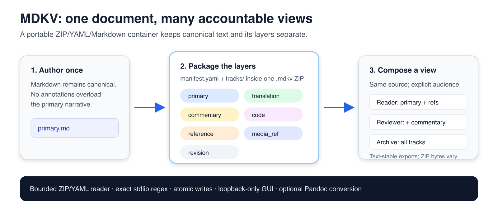

# MDKV: Multitrack Markdown Container (Python)

<p align="center">
  <a href="https://github.com/docxology/mdkv/actions/workflows/ci.yml"></a>
  <a href="LICENSE"></a>
  
</p>

MDKV packages related Markdown tracks in a portable ZIP file with a YAML
manifest. Use it to keep primary text, translations, commentary, code,
references, media links, and revision notes together while publishing
different views for different audiences.



- [Documentation index](docs/README.md)
- [CLI and Python usage](docs/usage.md)
- [Container format](docs/format.md) and [security boundaries](docs/security.md)
- [Manuscript](docs/manuscript/README.md) and [publication build](docs/publication.md)

## Quickstart

Install uv and run from this checkout:

```sh
uv sync --locked --extra dev
uv run mdkv init --title "Example" --author "You" --out example.mdkv
uv run mdkv validate example.mdkv
uv run mdkv export example.mdkv
```

The [CLI reference](docs/cli.md) includes track operations, search, exports,
and the loopback GUI.

## Development

Use the [verification guide](docs/verification.md) to run tests and build the
Sphinx site. See the [contribution guide](CONTRIBUTING.md),
[release history](CHANGELOG.md), and [backlog](docs/TODO.md).
