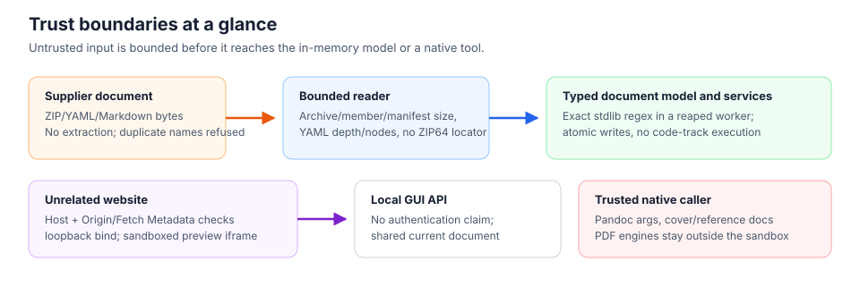

# Security Model: Supplier Input, Browser Origin and Native Conversion

## Threat model

MDKV accepts supplier-controlled ZIP/YAML, Markdown and metadata. The local GUI
also defends against a website contacting its loopback API. Trusted local users
choose paths and regexes. Same-user hostile processes, multiple-client isolation,
authentication, encryption and signatures are not provided.

## Containers and persistence

The reader never extracts ZIP entries. Duplicate ZIP names, YAML keys, track IDs
and track paths are rejected. ZIP64 is refused at both the ordinary end record and
the fixed 20-byte locator immediately before it, because the standard library would
otherwise select the locator's directory before our member-count checks run. YAML
anchors/aliases and custom constructors are
not accepted; nesting and node budgets apply before schema construction.
Malformed ZIP, UTF-8, YAML, schema, CRC and decompression data raises
`MDKVFormatError`; missing files raise `FileNotFoundError`.

The bounded archive profile accepts single-disk, non-ZIP64 stored/deflated ZIPs
without prepended/trailing data. Other compression methods are rejected before
decoding; older Python BZIP2/LZMA decoders cannot honor the same allocation bound.
Actual central-directory records are counted before `ZipFile` materializes them.
All members, including unreferenced binary extras, receive bounded size/CRC checks.

| Reader/writer boundary | Maximum |
|---|---:|
| Compressed archive | 128 MiB |
| Manifest | 1 MiB |
| One track | 16 MiB |
| Total declared uncompressed data | 64 MiB |
| ZIP members | 4096 |
| Tracks | 1024 |
| YAML depth | 32 |
| YAML nodes | 10000 |

Track paths are relative POSIX file paths below `tracks/`; empty, dot, parent,
backslash and NUL components are refused. Stored paths are member names, not host
paths. Tracks remain mutable, so both savers revalidate before publication.

Full and incremental saves serialize into unique same-directory temporaries and
replace only after completion. Failed saves preserve the prior file; existing
permission bits are retained. Replacement changes directory entries rather than
writing through destination symlinks/hard links. Atomic replacement is not a
power-loss durability or multi-process editing guarantee. Incremental save is a
full rewrite, not compressed-member reuse.

## Exports and rendering

File export preflights case-folded sanitized filename collisions before writing,
rejects symlink leaves and replaces regular destinations atomically per file.
It is not an all-or-nothing multi-file transaction or a filesystem sandbox.

Frontmatter is newline-delimited safe YAML. Canonical title/author/authors,
version and creation fields cannot be overridden by custom metadata. Metadata
comments are HTML-escaped, not an import grammar. ZIP/JSON preserve modeled fields
and track text; combined Markdown is not a lossless interchange format.

HTML rendering disables raw HTML and unsafe link schemes, with a pipe-table
extension. GUI diff descriptions are escaped; JSON diff uses text nodes. GUI
preview frames have an empty sandbox. HTML response CSP restricts active content
and preview resource fetching. Standalone exported HTML has no HTTP CSP and may
contain Markdown image URLs: viewing it can contact those resource hosts.

## GUI request boundary

Both the CLI and Python launcher refuse non-loopback bindings; allowed bind
names and Host headers are `localhost`, `127.0.0.1` and `::1`. Every API method
rejects foreign/null Origins and cross-site Fetch Metadata; origin comparison
includes scheme, hostname and effective port. No-Origin non-browser clients remain
supported. These controls are not authentication or a same-user sandbox. Do not
expose this server through a network proxy or trust forwarded host headers.

Local file selection/import remains intentional. Payloads are validated before
mutation, and failed opens/saves preserve prior state. The process has one shared
current document: independent clients can replace it. The browser serializes its
own edits, switches and saves, not another client's operations.

The editor changes one canonical track, independently of preview selection.
Unchanged saves preserve exact stored text. Edited HTML textareas normalize line
endings; revision history is not recorded automatically. Installed library
examples load read-only in memory and require an explicit local Save As path.

## Search and native converters

Search preserves stdlib `re` grammar, flags and Unicode offsets in a fresh
supervised interpreter. Input/startup is bounded to five seconds; compilation and
matching have a one-second deadline. The parent terminates and reaps timed-out or
cancelled workers. Patterns are limited to 16,384 characters and returned pages
to 10,000 matches; exceeding a budget raises an explicit error, never silently
truncates. Syntax failures retain `re.error`; timeouts raise `TimeoutError`
(GUI 408, CLI nonzero). Result limits alone do not prevent backtracking.
Async callers await supervisor I/O without blocking the event loop, then yield a
collected page. One interpreter per query adds startup/IPC overhead; no throughput
improvement or OS memory/filesystem sandbox is claimed.

Pandoc defaults use `--sandbox`, disable raw TeX/HTML and do not forward arbitrary
custom metadata as converter instructions. Destinations publish only after
conversion succeeds. Extra Pandoc arguments, cover images and reference documents
are trusted caller capabilities and may override restrictions. Pandoc's sandbox
does **not** isolate PDF engines: convert only trusted documents to PDF. External
Pandoc/TeX installations and OS policies remain outside MDKV's security boundary.
See the [Pandoc security guide](https://pandoc.org/MANUAL.html#security).
